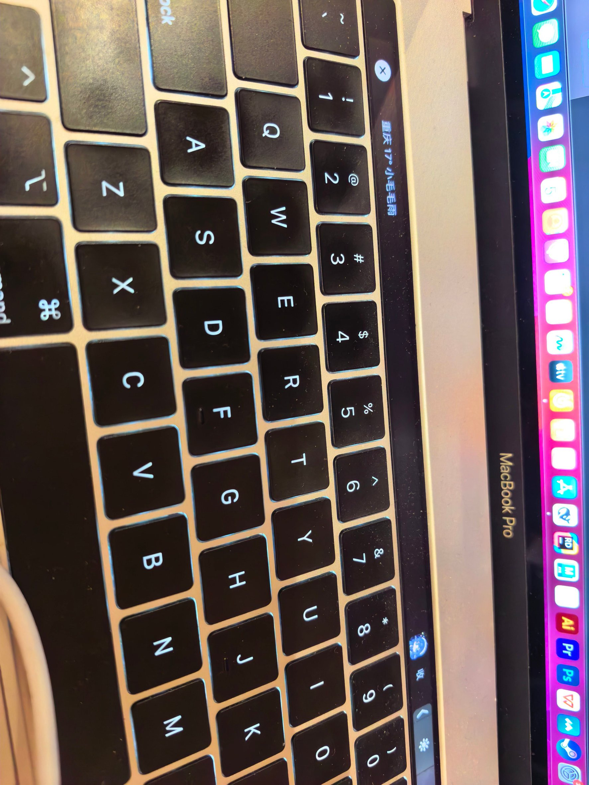

# Touch Bar 小鲸鱼

A tiny Touch Bar widget for macOS: weather, a live audio meter, real-time subtitles
(speech recognition + optional translation), and a whale button that opens your app.

> ⚠️ **只有 2016–2019 那些带 Touch Bar 的 MacBook Pro 能用。**
> 没有 Touch Bar 的机器（包括全部 Apple Silicon 笔记本）装不了，别试了。
>
> 只在 macOS 13.7（Intel）上实测过。

---

## 它是什么




占满 Touch Bar 的一行，从左到右：

```
[ 北京 12° 晴 ]  [ 律动条 / 字幕 ]  [ 🐳 ]  [ 收 ]
```

- **天气**：点一下打开系统天气 App
- **律动条**：把系统正在放的声音做成跳动的柱子
- **字幕**：把系统声音实时转成文字，还能翻译
- **鲸鱼**：打开你配置的应用（默认 `DeepSeek Harness`，可改成任何 app）
- **收**：隐藏整条，还你原生 Touch Bar

菜单栏那个鲸鱼图标管所有开关。

## 不需要装虚拟声卡

律动和字幕都直接用 **ScreenCaptureKit** 抓系统音频，不装 BlackHole、不切系统输出。

代价是需要授权（第一次运行会弹窗）：

```
系统设置 → 隐私与安全性
  ├─ 屏幕录制      （抓系统声音）
  └─ 语音识别      （把声音转成文字）
```

## 安装

```bash
# 1. 装依赖
python3 -m pip install -r requirements.txt

# 2. 生成两个 helper 的 .app（必须先打包，否则拿不到权限）
./build.command

# 3. 配置
cp config.example.json config.json
$EDITOR config.json          # 至少改 appName

# 4. 启动
python3 whale_touchbar.py
# 或者双击 启动.command
```

## 快捷键

| 快捷键 | 作用 |
|---|---|
| `⌘ ⌥ S` | 开关字幕 |
| `⌘ ⌥ M` | 开关音量律动 |
| `⌘ ⌥ H` | 显示 / 隐藏整条 |

用 Carbon 的 `RegisterEventHotKey`，**不需要辅助功能权限**。
菜单栏图标上会出现一个小圆点，表示字幕或律动正在跑。

## 配置

| 键 | 默认 | 说明 |
|---|---|---|
| `appName` | `DeepSeek Harness` | 点鲸鱼时启动哪个应用 |
| `bar.width` | `980` | 整条宽度（不同机型可调） |
| `weather.refreshSeconds` | `600` | 天气刷新间隔 |
| `subtitle.language` | `zh-CN` | 识别语言：`zh-CN` / `en-US` / `ja-JP` / `ko-KR` |
| `translate.provider` | `none` | `none` / `baidu` |
| `translate.to` | `zh` | 翻成什么语言 |
| `audio.autoSwitchOutput` | `false` | 旧行为：自动切到多输出设备（现在不需要） |

菜单里可以直接选**识别语言**和**翻译成**，改完 2 秒生效，不用重启。

## 翻译（可选）

默认**不翻译**，只显示识别出来的原文。想要翻译，得自己提供一个翻译源——没有内置的免费额度。

### 国内用户：百度翻译

[百度翻译开放平台](https://fanyi-api.baidu.com/) 申请「通用翻译 API」，免费额度每月 5 万字：

```json
"translate": {
  "provider": "baidu",
  "appid": "你的APPID",
  "key": "你的密钥",
  "from": "auto",
  "to": "zh"
}
```

免费版 **QPS = 1**，所以代码里做了两件事：限制请求间隔、把多句合并成一次请求。

### 海外用户：Google 网页接口

百度在国内很好用，但**服务在境外、需要中国手机号注册**，海外用不了。
国外可以用代码里已经实现好的 `google_free`（无需 key，走网页接口）：

```json
"translate": {
  "provider": "google_free",
  "from": "auto",
  "to": "zh"
}
```

> 这是**非官方接口**：可能限流、可能随时失效，别当生产用。
> 反过来，这个接口在**中国大陆基本连不上**，所以两边的用户各用各的。

### 想更稳的话

自己接 DeepL / Google Cloud / 腾讯云的正式 API，改 `translate.py` 里的
`_enabled()` 和 `translate()` 加一个分支就行，结构是留好的。

## 已知限制

- 只有 Touch Bar 机型能用
- 字幕有 1~2 秒延迟
- **唱歌识别不了**——带伴奏的唱词，ASR 基本都一样烂
- 日语/韩语**没有本地识别模型**，必须联网
- 翻译依赖第三方 API，断网或超额度就只显示原文

## 踩过的坑（都写进代码注释了）

| 现象 | 原因 |
|---|---|
| 一个回调都不来 | `SCStream` 被 GC 回收，必须一直持有 |
| 有数据但读不出来 | PyObjC 的 `CMSampleBufferRef` 没有 `.dataBuffer()`，要用 `CMSampleBufferGetDataBuffer()` |
| 数据被丢弃 | `CMBlockBufferCopyDataBytes` 返回 `(状态, buffer)` 元组，不是单个状态码 |
| 识别成乱码 | SCK 音频是**平面布局**（前 N 左声道、后 N 右声道），不是交错的 |
| 切几次就彻底不识别 | 识别任务必须在**主线程**创建，后台线程建会一直报 209 |
| 字幕只剩一个句号 | 按长度切 delta 会把句子切碎，要等文本稳定后整句处理 |
| 菜单项是灰的 | `@python_method` 装饰器会让 ObjC 看不见这个方法 |

## TODO / 欢迎接手

- [ ] 设置界面（现在只能手改 JSON）
- [ ] 更多翻译源（DeepL / 腾讯 / 本地模型）
- [ ] Apple Silicon + 外接 Touch Bar 的验证
- [ ] 打包成自包含 .app（要绑 Python，体积会大）

## 许可

MIT，见 `LICENSE`。
